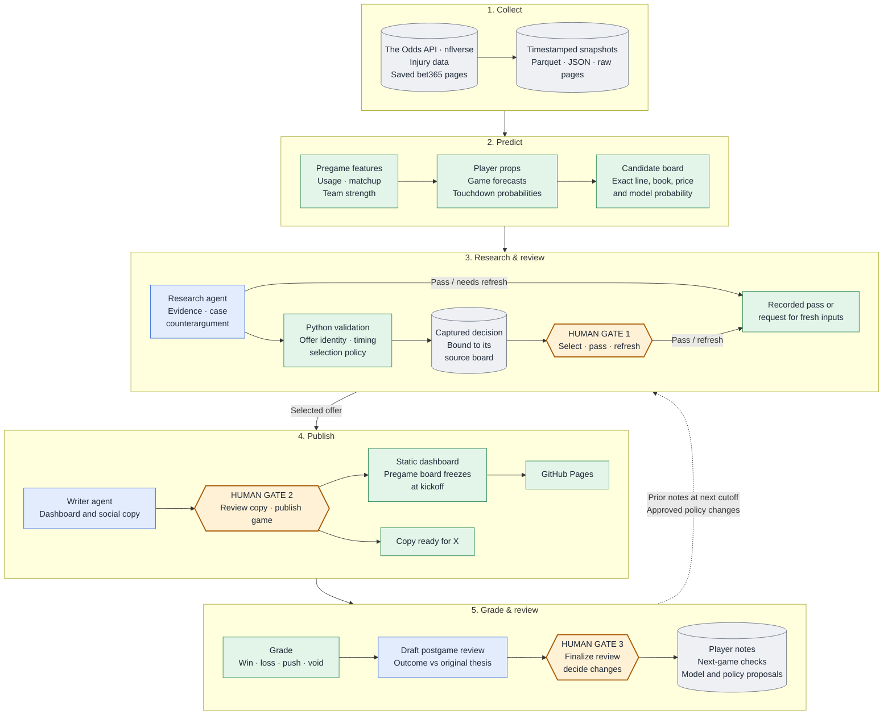

# NFL model dashboard

**[View the dashboard →](https://johanntin.github.io/NFL/)**

**[View X account →](https://x.com/TinAlgo)**

A published snapshot of the game and player-prop board: market lines by book,
the model's prices against them, the offers that clear the EV floor, and the
writeup behind each pick.

<details>
<summary><h2>How it works</h2></summary>

### Overview: the five-stage workflow

- **What it is:** TinAlgo, a human-in-the-loop NFL research and picks system.
- **Who does what:** scheduled jobs collect data, models estimate
  probabilities, AI agents research candidates, and a human reviewer decides
  what gets published.
- **Learning loop:** results are reviewed after each game before any finding
  changes the system.
- **Scope:** one developer built and maintains the whole system, covering data
  collection, model training, agent coordination, the review interface and
  publishing.
- **Traceability:** each stage leaves a record the next stage can inspect,
  from the original price snapshot to the postgame review.

| Stage | What happens | Output |
|---|---|---|
| **1. Collect** | Capture sportsbook odds, NFL statistics, rosters and injury information. | Source data and timestamped odds snapshots. |
| **2. Predict** | Build pregame features, estimate outcome probabilities and compare them with offered prices. | Forecasts and a board of candidates with positive estimated expected value. |
| **3. Research & review** | Agents examine the evidence; Python validates the recommendation; the reviewer selects, passes or requests fresh inputs. | A captured decision with supporting evidence. |
| **4. Publish** | An agent drafts the write-up; the reviewer inspects it and publishes the game's dashboard record. | Published selections with their prices and reasoning; social copy ready to post. |
| **5. Grade & review** | Code settles picks; the reviewer checks the result and finalizes follow-up notes and proposals. | Graded results and human-reviewed next steps. |

- Collection runs on a schedule.
- Model scoring, review, publication and postgame tasks run one game at a time
  from a local admin panel.

---

### Architecture



- **Colours:** blue boxes are AI agents, green boxes are Python code and models,
  grey cylinders are stored data, and amber hexagons are the three human gates.
- **Loop:** the dashed arrow carries finalized player notes (available at the
  next cutoff) and approved policy changes from stage 5 back into research and
  validation in stage 3.

---

### Where the human makes the decision

- The AI proposes picks and drafts the explanations.
- The human reviewer decides:
  - whether the evidence supports a pick
  - whether the quoted price is still worth taking
  - whether a postgame result calls for further work

| Checkpoint | What the reviewer inspects | Decision and record |
|---|---|---|
| **Pregame selection** | The exact offer, model probability, source timestamps, injury context, supporting evidence and counterargument. | Select the offer, pass with a reason, or request a fresh board. A validated decision is captured against its source data; a changed decision needs a new capture. |
| **Before publication** | The final write-up, cited claims, price, line and stake against the captured decision. | Approve or revise the copy, then publish that game's dashboard record from the admin panel. Social text remains ready for a separate post. |
| **After the game** | The grade alongside the original claims and what actually happened on the field. | Edit and finalize the review, creating player notes, next-game checks and model proposals. Proposed policy or model changes require a separate human decision. |

- Python checks enforce data and selection rules at key handoffs.
- They catch invalid offers, stale inputs and any change between the captured
  decision and the text readers see, supporting human review rather than
  replacing it.

---

### 1. Collect: data collection and storage

- **Schedule:** the odds collector runs from cron on an always-on Mac, and a
  daily discovery job finds upcoming games.
- **Game days:** refreshes run hourly in the early morning and every 30 minutes
  later in the day (US Eastern Time).
- **Coverage:** 12 player and game markets across several sportsbooks.
- **NFL data:** nflverse supplies statistics, play-by-play, rosters, snap counts
  and depth charts; injury refreshes add availability context.
- **bet365:** saved pages can be uploaded through the admin panel and parsed as
  an extra odds source.
- **Alerts:** Telegram flags collection problems that need attention.
- **Storage:** snapshots and model outputs are stored as Parquet and JSON; raw
  book pages are archived for inspection.
- **Traceability:** captured board packets and decision receipts preserve the
  exact inputs behind each recommendation, while current output files can be
  rebuilt.
- **API budget:** paid calls are concentrated around game days, budgeted at
  roughly 30,000 credits a month against a 100,000-credit allowance; actual
  usage depends on the slate.

---

### 2. Predict: features, models and candidate selection

- **Features:** recent targets, carries and catches, share of team usage,
  opponent strength and Elo ratings.
- **No look-ahead:** every forecast uses a pregame cutoff, with availability and
  timestamp checks.

| Model | Role |
|---|---|
| **Player props** | LightGBM threshold classifiers estimate outcomes such as four or more catches. A frozen correction combines the statistics-based forecast with a sportsbook reference probability at the same line, excluding the target book's family. |
| **Game forecasts** | Produce home-win probabilities, projected spreads and total points for the dashboard. |
| **Touchdowns** | Provide a statistics-only forecast and a second forecast that also incorporates a sportsbook probability. |

- **Training:** the 2026 player-prop bundle trains its fundamental classifiers
  through 2024 and calibrates them on the completed 2025 season.
- **Frozen for the season:** parameters stay fixed for 2026; only pregame
  features and prices update.
- **Candidate board:** evaluates every exact combination of player, market,
  line, side and book.
- **Expected value:** for a bet that can only win or lose:

```text
Expected value per unit staked = model win probability × decimal odds − 1
```

- A positive value marks an offer worth reviewing.
- The probability gap and the expected return are different quantities: in the
  example below, a 1.4-percentage-point gap produces a 2.36% expected return.

---

### 3. Research & review: agents, validation and the human gate

- **Research agents** examine usage, matchups, injuries and prior player notes.
- **Each recommendation records** the supporting evidence, the counterargument,
  an ordinary way the pick could lose, and what new information would change
  the decision.
- **Evidence IDs** back every material factual claim.
- **Model probabilities stay unchanged:** agents can select, pass or request
  fresh inputs, but don't edit the forecasts.
- **Python validators** check offer identity, arithmetic, timing, evidence
  references and selection-policy requirements.
- **Selection policy** (dated November 8, 2026):
  - caps estimated expected return at 10%
  - requires a model win probability of at least 50%
  - rejects forecasts explicitly identified as lacking a fundamental model
    component
- These are versioned selection rules; they don't alter the underlying
  forecasts.
- Validation catches structural and numerical errors; interpreting sources
  still needs human review.
- **Receipts:** before drafting begins, a validated recommendation is captured
  in a local receipt linked by content hashes to its source board.
- The writer carries the selected offers, claims and stakes into the dashboard
  text and social copy; any change to the decision requires a new capture.
- Records made before receipts were bound to their boards stay labeled as
  unbound.
- **Separate steps:** the Flask admin workflow keeps selection and publication
  apart. A reviewer can pass on a game, and the writer does not turn a pass
  into a pick.

---

### 4. Publish: dashboard and social copy

- **Dashboard:** Python builds a static HTML, CSS and JavaScript site showing
  prices by book, model forecasts, selections and write-ups.
- **Hosting:** a publish script pushes the generated site to GitHub Pages.
- **Kickoff freeze:** saved pregame boards freeze at kickoff, so routine
  rebuilds keep the original selections.
- **Social:** workflows prepare copy for picks and weekly recaps.

---

### 5. Grade & review: postgame learning

- **Grading:** code settles saved selections as win, loss, push or void from
  result data.
- **Postgame review** compares the result with the original thesis:
  - Did the expected opportunity occur?
  - Did efficiency differ?
  - Did the game unfold differently?
- **Video context:** optional Whisper transcripts add timestamped game-video
  context.
- **Follow-up:** the reviewer finalizes each review into player notes, checks
  for future games, and model or policy proposals, then decides which to test
  or adopt.
- **Stable models:** deployed models stay fixed until deliberately replaced.

---

### Example: one pick from price to result

The saved Week 9 Denver–Carolina write-up shows how the pieces connect:

| Stage | Courtland Sutton under 3.5 receptions |
|---|---|
| **Price** | The captured DraftKings offer was **−145**, equivalent to a **59.18%** break-even probability. |
| **Prediction** | The model assigned **60.58%** to the under: a **1.40-percentage-point** probability gap and **2.36%** estimated expected return. |
| **Research** | Sutton had stayed below four catches in seven of eight recorded games. His last four target totals were 3, 3, 5 and 4. |
| **Counterargument** | Four catches on four targets had beaten the line the previous week. The recommendation also flagged a rebound in targets as a way to lose. |
| **Human decision** | The reviewer selected the exact DraftKings offer at one unit after reviewing the case and its counterargument. The write-up carries a recommendation receipt reference and two testable claims: at most five targets and at most three catches. |
| **Result** | Sutton finished with **five catches on nine targets**. The pick lost, and both recorded claims failed. |

- **Takeaway:** the expected target ceiling did not hold, which gives future
  research a concrete question to answer.
- **Limit:** a single outcome can't show whether the model probability was well
  calibrated.

---

### Tech stack

| Area | Tools |
|---|---|
| Languages | Python, JavaScript, Bash |
| Data | pandas, NumPy, Parquet, JSON |
| Machine learning | LightGBM, scikit-learn, SciPy |
| AI workflows | Codex, Claude / Anthropic API, LangGraph |
| Data sources | The Odds API, nflverse / nfl_data_py, ESPN, uploaded bet365 pages |
| Interfaces | Flask admin panel; static HTML, CSS and vanilla JavaScript dashboard |
| Hosting and automation | GitHub Pages, macOS server, cron, shell scripts |
| Alerts and media | Telegram, ffmpeg, Whisper |
| Quality | pytest coverage for data handling, model inputs, validation, publishing and admin workflows; Git version control |

---

### Engineering highlights

- **Decision traceability.** Captured boards, evidence references and receipts
  connect a published pick to the inputs and reasoning behind it.
- **Human control at three gates.** A human decides which candidates become
  picks, inspects the final write-up before publication, and finalizes postgame
  learning.
- **Time-aware data handling.** Source timestamps, pregame cutoffs and kickoff
  locks help preserve what was known when a decision was made.
- **Controlled evaluation.** Frozen model bundles and recorded passes support
  comparisons across every opportunity reviewed, including rejected picks.
- **Practical operation.** Game-scoped workflows, scheduled collection and
  static hosting keep the system manageable for one operator.

</details>
